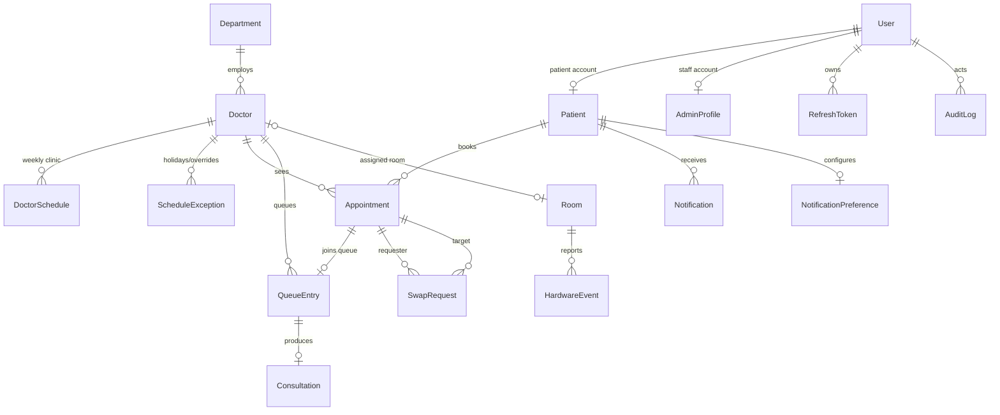

# Database guide

PostgreSQL 16 via Prisma 6. The schema lives in `apps/api/prisma/schema.prisma`;
there is exactly one place for the enums, and a drift test
(`apps/api/test/enum-drift.test.ts`) fails if they diverge from
`packages/shared/src/enums.ts`.

## Migrations

```bash
pnpm db:migrate --name add_something   # dev: create + apply + regenerate client
pnpm db:deploy                         # CI/production: apply pending migrations
pnpm db:reset                          # drop, migrate, seed (local only)
```

Every `db:*` script runs through `apps/api/scripts/with-env.mjs`, which loads the
single root `.env`. The Prisma CLI only reads `.env` from its own working
directory, so do not call `prisma` directly from `apps/api`.

Conventions:

- Never edit an applied migration. Add a new one.
- Raw SQL is allowed when Prisma cannot express the constraint (for example the
  partial unique indexes on `PENDING` swap requests).
- `migrate dev` may ask to reset after a destructive change. On a machine with
  demo data you want to keep, generate SQL with `prisma migrate diff` instead.

## Time and days

- All instants are UTC `DateTime`.
- Hospital-local calendar days are stored as `serviceDay` (`YYYY-MM-DD`) on
  `Appointment` and `QueueEntry`. This keeps "today's queue for Dr. Rao"
  queryable without timezone functions in SQL.
- Use `toDayKey`, `zonedDateTimeToUtc`, `addDaysToDayKey` from
  `@waitless/shared` — never `new Date("09:00")`.

## Entity relationships



## Invariants worth knowing

| Invariant | Enforced by |
|---|---|
| One appointment per doctor per slot | `@@unique([doctorId, slotStart])` |
| Token number unique per doctor per day | `@@unique([doctorId, serviceDay, tokenNumber])` |
| One queue entry per appointment | `QueueEntry.appointmentId @unique` |
| One pending swap per appointment (either role) | partial unique indexes in `20261113062500_swap_pending_unique` |
| Hardware replays ignored | `HardwareEvent.dedupeKey @unique` |
| Notification sends idempotent | `Notification.dedupeKey @unique` |
| Contiguous queue positions | Queue service (cannot be expressed without deferrable constraints) |

## Seeding

`pnpm db:seed` is idempotent for structural rows (departments, doctors, rooms,
schedules, staff, patients). Demo-day appointments are tagged `[seed]` and
recreated on each run, so repeated seeding never accumulates duplicates.

The seed picks the next non-Sunday day in `HOSPITAL_TIMEZONE` as the demo day and
prints the credentials for both staff accounts.
