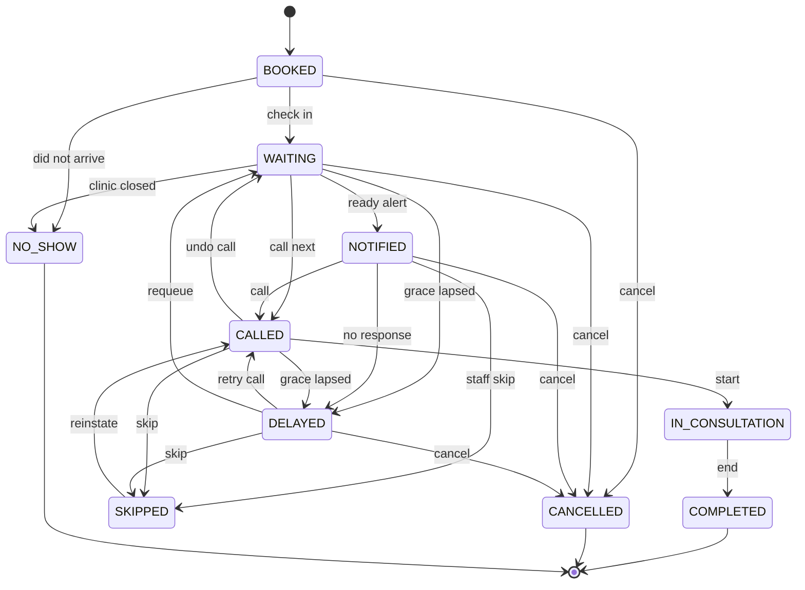

# Appointment state machine

The backend is the only authority over appointment status. The web client
requests **actions** (`cancel`, `call`, `start`, `complete`, `skip`) and never
sets a status field directly. Every action is validated against this table
before any row is written.

Source of truth: `packages/shared/src/state-machine.ts` (covered by
`packages/shared/test/state-machine.test.ts`).

## Transitions

| From | Allowed next states |
|---|---|
| `BOOKED` | `WAITING`, `CANCELLED`, `NO_SHOW` |
| `WAITING` | `NOTIFIED`, `CALLED`, `DELAYED`, `CANCELLED`, `NO_SHOW` |
| `NOTIFIED` | `CALLED`, `DELAYED`, `SKIPPED`, `CANCELLED` |
| `CALLED` | `IN_CONSULTATION`, `DELAYED`, `SKIPPED`, `WAITING` |
| `DELAYED` | `CALLED`, `WAITING`, `SKIPPED`, `CANCELLED` |
| `IN_CONSULTATION` | `COMPLETED` |
| `SKIPPED` | `CALLED` |
| `COMPLETED` | — (terminal) |
| `CANCELLED` | — (terminal) |
| `NO_SHOW` | — (terminal) |

Self-transitions are always rejected. Anything not listed returns
`INVALID_TRANSITION` (HTTP 409).

## Diagram

## Semantics

- `NOTIFIED` means "an alert was sent", not "the patient is in the room". It is
  still a waiting state and can always move back into the normal flow.
- `CALLED` starts the grace timer (`GRACE_MINUTES`, default 10). Missing it moves
  the patient to `DELAYED`; a further `DELAY_MINUTES` of silence allows an
  automatic `SKIPPED`.
- `SKIPPED` is recoverable: staff can call the patient again. `COMPLETED`,
  `CANCELLED` and `NO_SHOW` are final.
- Patients may cancel from `BOOKED`, `WAITING`, `NOTIFIED` and `DELAYED` only.
  Once called or in the room, cancellation is a staff decision.

## Actions in practice

| Action | Endpoint (planned) | Result |
|---|---|---|
| Cancel (patient) | `POST /appointments/:id/cancel` | terminal `CANCELLED` |
| Check in | `POST /appointments/:id/check-in` | `WAITING` + queue entry |
| Call | `POST /queue/:doctorId/call-next` | `CALLED`, grace deadline set |
| Start | `POST /queue/entries/:id/start` | `IN_CONSULTATION`, consultation row |
| Complete | `POST /queue/entries/:id/complete` | `COMPLETED`, ETA recalculation |
| Skip | `POST /queue/entries/:id/skip` | `SKIPPED`, position released |
| Requeue | `POST /queue/entries/:id/requeue` | `CALLED`/`WAITING` per policy |
| Swap accept | `POST /swaps/:id/accept` | both appointments exchange slot + token |
